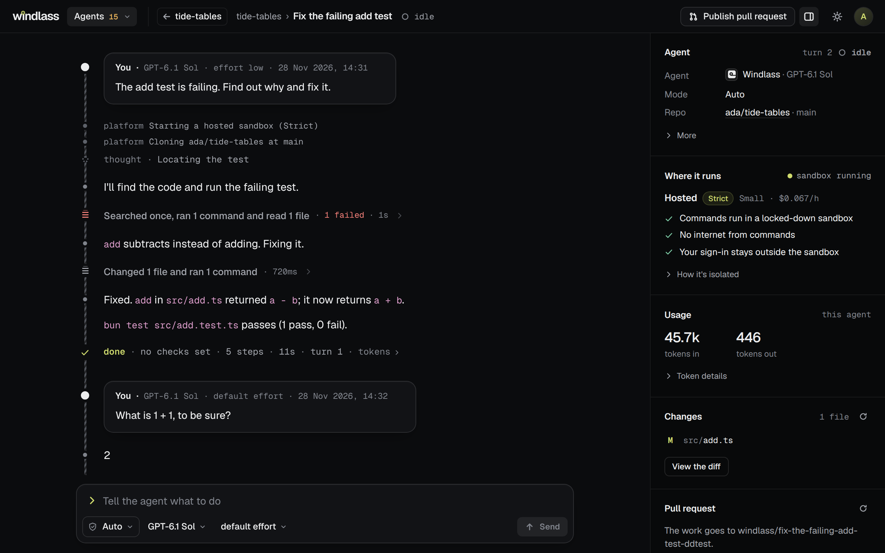
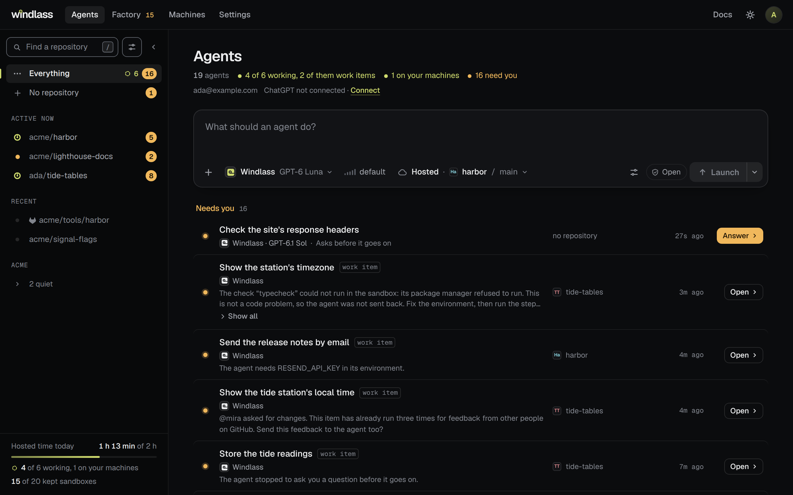
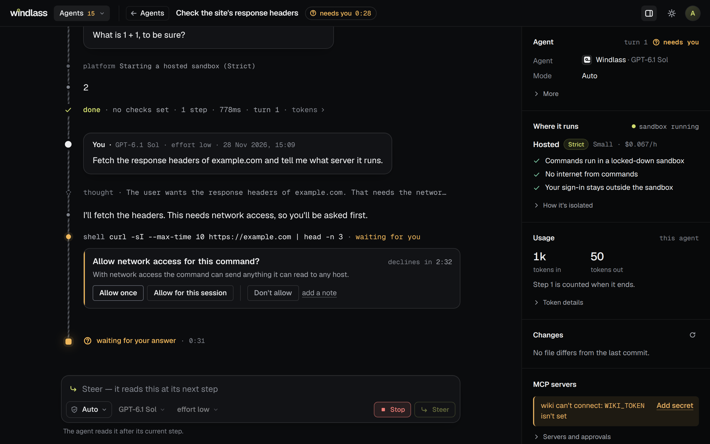
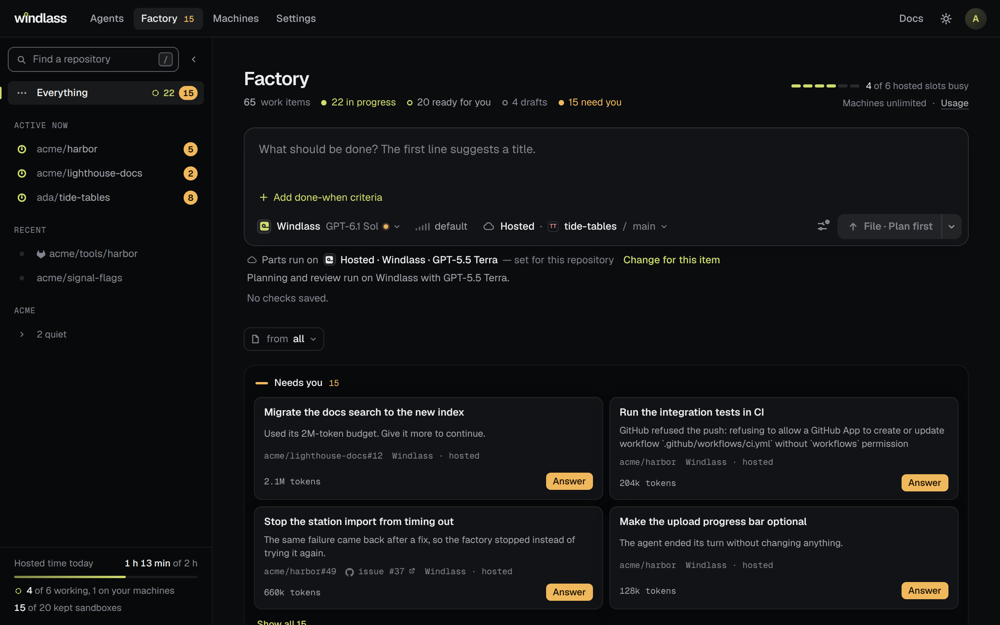
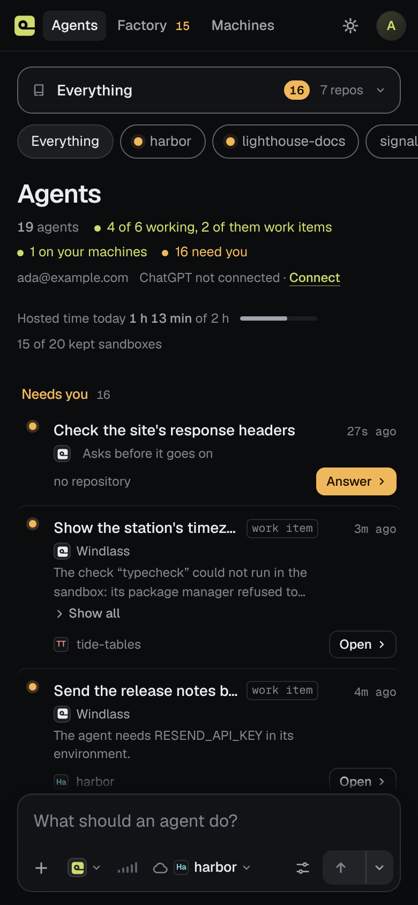

# Windlass Platform

Windlass Platform runs coding agents for you in sandboxes, on your GitHub repositories, and hands their work
back as pull requests. You sign in with GitHub or Google, start an agent from the browser, and watch every file it
reads and every command it runs as it happens. It runs [Windlass](https://github.com/WindlassAI/windlass), the
terminal coding agent, and is built on [Rivet Actors](https://www.rivet.dev/actors/docs).

- **Using it:** the user docs, at <https://usewindlass.com/docs> (source in
  [`web/src/docs/content/`](web/src/docs/content/)).
- **Running, self-hosting or working on it:** the developer and operator docs, in [`docs/`](docs/README.md).



<details>
<summary>More screenshots</summary>










</details>

## What it does

- **Sessions in sandboxes.** Each agent works in a sandbox of its own: a Docker container, an E2B microVM,
  or a container on a Linux machine of yours. Windlass's own command sandbox can add a second layer, with
  no network and no access token for the agent's commands.
- **Your own machines.** A small runner on a machine with Docker connects out to the platform and runs the
  sandboxes there. Nothing needs to reach the machine, and the platform's usage limits do not apply.
- **Network modes on your machines.** Each machine chooses `restricted` (public sites through a checking
  proxy), `open` or `none` for its agents' commands.
- **Claude Code and OpenCode as well as Windlass.** On your own machine, an agent can be Claude Code, signed
  in with your Claude account, or OpenCode, with any API-key provider it knows or its free public models.
  Sign-in happens in the machine's terminal, and the keys stay in a relay outside the session container.
  Codex is planned.
- **Live sessions you can steer.** The timeline streams reasoning, tool calls and answers. You answer the
  agent's questions, steer a running turn, stop one call or the whole turn, and read the diff.
- **Pull requests with evidence.** The platform pushes and opens the pull request itself, so the sandbox
  never holds your GitHub access. The description says which checks ran and how they ended.
- **Repository settings.** A setup command, required checks, write-only secrets and remembered approvals of
  the repository's MCP servers. Your account adds its own MCP servers, secrets and defaults.
- **The Factory.** File a work item and an agent carries it to a pull request: it works, runs your checks,
  waits for CI, fixes what failed and hands it to you with a verdict. **Orchestrate** splits a feature into
  subtasks you approve, landing as one pull request. An optional second agent reviews the work. Items can be
  filed in the web app, from a GitHub issue or through an API. The platform never merges.
- **Limits from the start.** Daily sandbox time, kept sandboxes, agents running at once and per-item
  budgets, all set by the deployment.

## Quick start

Run the demo with Node.js 22.22.2 (or a newer 22.x patch) and pnpm 11.25.0, on Linux x64 or arm64. Fake
sandboxes replay recorded Windlass sessions and need no Docker, account or API keys.

```sh
corepack enable pnpm
pnpm install --frozen-lockfile
WLP_SANDBOX=fake pnpm dev:server
```

In a second terminal, run `pnpm dev:web`. Open <http://localhost:5173/signin> and choose **Try the demo**.

To run real containers with Docker, or the web app with no server at all, see
[docs/development.md](docs/development.md#run-it).

## Self-hosting

The [self-host guide](deploy/selfhost/README.md) runs the platform on one Linux host with Docker Compose:
the Rivet engine, the server with the web app, backups and a load test. Agents never run on the platform
host itself; pair a machine of yours or use hosted sandboxes for them. For several servers, E2B and the
GitHub App, see [docs/operating.md](docs/operating.md), and for every setting
[docs/configuration.md](docs/configuration.md).

## Project layout

| Path | What it holds |
|---|---|
| `server/` | The server: one Rivet node with the actors, the sandbox layer and the platform's HTTP routes |
| `web/` | The web app (Vite, React), the public pages and the user docs |
| `runner/` | The runner for a user's own machine |
| `sandbox/` | The sandbox images, the E2B template, the Claude Code image and its relay |
| `deploy/selfhost/` | The Docker Compose kit for one host |
| `scripts/` | The development server and the checks |
| `docs/` | Developer and operator docs |

[docs/development.md](docs/development.md#layout) has the full layout.

## Development and checks

```sh
pnpm typecheck
WLP_SANDBOX=fake pnpm test
```

[docs/development.md](docs/development.md#checks) lists every focused check, including the Docker and E2B
ones. [CONTRIBUTING.md](CONTRIBUTING.md) says how to send a change.

## Security

Report vulnerabilities privately as [SECURITY.md](SECURITY.md) describes. What each sandbox protects is in
the user docs' [Sandboxes and security](https://usewindlass.com/docs/security) page.

## License

[Apache-2.0](LICENSE). Third-party components keep their own licenses; see [NOTICE.md](NOTICE.md).
